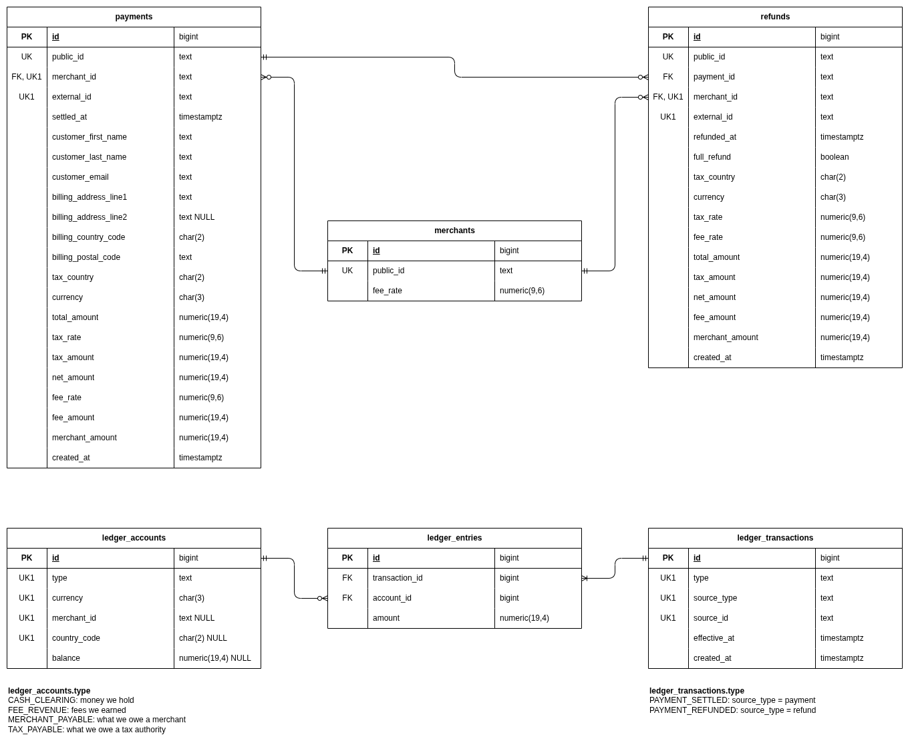

# Homework MoR Ledger Service Design

## Context & Problem Statement

A Merchant of Record (MoR) is the seller of record:
it collects payment from the customer, is liable for remitting sales tax/VAT to the relevant tax authority,
takes its own fee, and owes the remainder to the merchant.

The goal was to build a small (:shrug:) MoR ledger service exposing APIs to:

1. **Capture a payment** — Record that a customer payment was captured for a given merchant.
2. **Refund a payment** — Record a refund against a previously captured payment.
3. **Balances Report** —
    - How much does the MoR owe tax authorities?
    - What are merchants' balances with the MoR?

Beyond the task, the service also records **payouts** of a merchant's balance (see [Payouts](#payouts)).

Additional assumptions from the task:

- MoR takes a single flat % fee from its customers (*Merchants*)
- Tax Rate is communicated in the captured payment payload
- Multi-currency is a nice-to-have
- Partial refunds are a nice-to-have

## Solution Design

### Requirements analysis

The main flow requested in the requirements: recording that a customer payment was captured for a given merchant.  

The assumptions and conclusions that affected the application design:

1. We only **record** that a payment has been already captured — the actual payment processing happens outside our system;

2. In general, we may assume that since the payment was already captured — it has been already calculated properly.  
  I.e. if this was a payment for a sale, some another system *already calculated* the total for the payment,  
  taking into account individual line items, unit price, quantities, and even taxes — we get only the `totalAmount`  
  and the `taxRate` that was used for calculations.

3. Taking into account the line on taxes from the task (`Tax Rate is communicated in the captured payment payload`),
it was decided to approach taxes with __*!great simplification!*__ — that one `taxRate` is enough to represent and calculate  
Tax Amount paid by the customer.  
The author *knows* (*heard*, rather) that taxes can be multi-leveled, have different applicability logic (included or excluded),
but this complexity was left out of scope. I'm sorry if that is unacceptable.

4. Also, knowing that multi-currency is a nice-to-have feature, I've tried to build it in initially.  
  It gave me the hint that:
    - There could be customers paying to the same Merchant in different currencies;
    - And as a consequence, we (the MoR) will need to pay the taxes in different countries (jurisdictions);

5. To support multi-currency, it was decided that one Merchant may have **>1 balance** in the system,  
  per the number of currencies from the recorded payments.   
  For tax statements, though, only grouping per currency is not enough, since each country wants its taxes separately,  
  even if the currency matches between countries (hello, European Union).

### Architecture

The application is a modular monolith, consisting of 4 modules:

- Merchants
- Payments (w/Refunds)
- Payouts
- Ledger

Each module is structured in accordance with the Hexagonal architectural style:

  - The inner *core* of the module contains the domain entities and business logic, frameworks-agnostic.
  - The inner core defines *ports* (interfaces), that the outer *adapters* implement.
  - Modules can call the logic from another module through the port, defined in the core, and implemented by the adapter.
  - There is no shared persistence or controllers layer, each module contains its own stuff.
  - Modules boundaries are enforced with the help of *ArchUnit* tests.

Modules dependencies are:

```
payments ──▶ merchants ──▶ ledger
    └──────────────────────▶ ledger
payouts  ──▶ merchants
    └──────────────────────▶ ledger
```

1. The "Ledger" module is responsible for storing ledger accounts and recording transactions against them (double-legged ledger transactions).  
  It does not depend on any module.
  All balances accumulate in this module.
2. "Merchants" module store the information about Merchants (like their fee with MoR, for example), and communicate with
the "Ledger" module to get the Merchant's balances with the MoR.
3. "Payments" module depends on both "Merchants" and "Ledger" modules.  
  This module captures Payments and Refunds from the REST API.
  The information about the Merchant (e.g. the MoR fee rate) is requested from the "Merchants" module.
  Total Amount of a Payment is then split between the Merchant, Tax Authorities and our own Revenue (*Ledger Transaction Entries*).
  The payment transaction (and all the lines) are posted to the "Ledger".
4. "Payouts" module depends on both "Merchants" and "Ledger" modules, and doesn't know "Payments" (nor the other way round).
  It records payouts to merchants from the REST API, and posts each step of a payout's life to the "Ledger":
  the hold when it's requested, then its settlement or release.

#### Communications

To achieve strong consistency, the "Payments" module stores Payment/Refund and posts to the "Ledger" module synchronously
in scope of one DB transaction. The "Payouts" module does the same with Payouts.

### Data model



### Business logic

#### Payment and Refund amounts split

All amounts are rounded to the currency's decimal places.

A Payment's `totalAmount` is split as follows:

- `net = total / (1 + taxRate)`, rounded half-up;
- `tax = total − net`;
- `fee = net × feeRate`, rounded half-up;
- `merchant = net − fee`.

Rounding remainders go to the merchant, so `tax + fee + merchant = total` always holds.

A Refund is split using the Payment's own split, scaled to everything refunded so far (`refundedTotal`), including this refund:

- `tax = payment tax × refundedTotal / payment total`, rounded half-up;
- `net = refundedTotal − tax`;
- `fee = payment fee × net / payment net`, rounded half-up;
- `merchant = net − fee`.

The Refund's split is that cumulative split minus the sum of the previous Refunds' splits.
Rounding never accumulates, and the Refunds of a fully refunded Payment add up to exactly the Payment's split.

#### Payouts

A payout sends (part of) a merchant's *available* balance to their bank account. Sending money takes time
(seconds to days) and can fail, so a payout is recorded in three steps, each one a ledger transaction:

1. **Hold** (`PAYOUT_HELD`), when the payout is requested: the amount moves from *Merchant Payable* (available) to
   *Merchant Payout Pending*. We still owe the merchant as much as before, but it can't be paid out again.
   Cash doesn't move: the money is still in our bank account.
2. Then the bank answers, and the payout ends once, either way:
    - **Settle** (`PAYOUT_SETTLED`): the money left our bank account. The amount moves from *Merchant Payout Pending*
      out of *Cash Clearing*: we no longer owe it.
    - **Release** (`PAYOUT_RELEASED`): the bank rejected it. The amount moves from *Merchant Payout Pending* back to
      *Merchant Payable*, available to pay out again. Cash never moved.

The hold is the only step that checks funds: under the *Merchant Payable* row lock, it is rejected unless the
available balance covers it. The check and the debit happen while the lock is held, so concurrent payouts
(the scheduler and a "withdraw now" click, or a retry) can't each see the same balance and pay it out twice;
and a payment or refund that arrives meanwhile waits for the lock instead of being overwritten.

Settling and releasing don't need a funds check: the `payouts` row is locked and moves from `PENDING` to `SETTLED` or
`FAILED` once, so a payout can't be both settled and released, and repeating a request posts nothing more.

Refunds don't check funds. A refund after a payout has settled may leave the merchant's available balance negative:
they now owe us. That is a business case the hold can't prevent (the money has left), and it's left to policy
(payout delays, rolling reserves, netting against future sales), which is out of scope here.
Until the balance is positive again, every new payout is rejected.

#### Ledger accounts and reporting

The Ledger is a double-entry ledger made of three tables:

- `ledger_accounts`: one account per type and key:
    - *Cash Clearing* (per currency): money the MoR holds;
    - *Fee Revenue* (per currency): fees the MoR earned;
    - *Tax Payable* (per currency + country): what the MoR owes a tax authority;
    - *Merchant Payable* (per currency + merchant): what the MoR owes a merchant and can pay out now (*available*);
    - *Merchant Payout Pending* (per currency + merchant): what the MoR still owes a merchant, but has already held
      for payouts in flight (*pending*).
- `ledger_transactions`: one row per business event (`PAYMENT_SETTLED`, `PAYMENT_REFUNDED`,
  `PAYOUT_HELD`, `PAYOUT_SETTLED`, `PAYOUT_RELEASED`),
  pointing back to the Payment, Refund or Payout that caused it, with its `effective_at` time.
- `ledger_entries`: the lines of a transaction, each moving an amount on one account.
  A positive amount is a debit, a negative one is a credit, and the entries of one transaction always sum to zero.

Entries are append-only: nothing is ever updated or deleted, a Refund is recorded as a new transaction
with the Payment's lines reversed. Any balance is therefore just the sum of the account's entries.
Liabilities (*Tax Payable*, *Merchant Payable*, *Merchant Payout Pending*) and revenue end up with negative balances,
so reports flip the sign.

Accounts are created on first use. Only *Merchant Payable* accounts keep a cached `balance` column,
updated under a row lock in the same transaction that posts the entries.
That lock serializes everything that moves a merchant's available money: payments, refunds and payout holds.
The other accounts are shared by all merchants and would become hot rows, so their balances are summed on demand
(pending payouts are few, so they don't need a cache either).

##### Example

Merchant `MERCH-001` (3% fee) records a payment of `119.00 EUR` from a German customer at a 19% tax rate,
then a partial refund of `59.50 EUR`, and then gets everything it's owed paid out:

- Payment: `net = 119.00 / 1.19 = 100.00`, `tax = 19.00`, `fee = 3.00`, `merchant = 97.00`;
- Refund: `tax = 19.00 × 59.50 / 119.00 = 9.50`, `net = 50.00`, `fee = 3.00 × 50.00 / 100.00 = 1.50`, `merchant = 48.50`;
- Payout `PO-0123456789` of the `48.50 EUR` left: held when requested, settled when the bank confirms it.

`ledger_accounts`:

| id | type                    | currency | merchant_id | country_code | balance |
|----|-------------------------|----------|-------------|--------------|---------|
| 1  | CASH_CLEARING           | EUR      |             |              |         |
| 2  | TAX_PAYABLE             | EUR      |             | DE           |         |
| 3  | FEE_REVENUE             | EUR      |             |              |         |
| 4  | MERCHANT_PAYABLE        | EUR      | MERCH-001   |              | 0.00    |
| 5  | MERCHANT_PAYOUT_PENDING | EUR      | MERCH-001   |              |         |

`ledger_transactions`:

| id | type             | source_type | source_id      | effective_at         |
|----|------------------|-------------|----------------|----------------------|
| 1  | PAYMENT_SETTLED  | payment     | PAY-0123456789 | 2026-10-01T10:00:00Z |
| 2  | PAYMENT_REFUNDED | refund      | REF-0123456789 | 2026-10-02T09:00:00Z |
| 3  | PAYOUT_HELD      | payout      | PO-0123456789  | 2026-10-03T07:00:00Z |
| 4  | PAYOUT_SETTLED   | payout      | PO-0123456789  | 2026-10-05T08:00:00Z |

`ledger_entries`:

| id | transaction_id | account_id             | amount  |
|----|----------------|------------------------|---------|
| 1  | 1              | 1 (Cash Clearing)      | 119.00  |
| 2  | 1              | 2 (Tax Payable DE)     | -19.00  |
| 3  | 1              | 3 (Fee Revenue)        | -3.00   |
| 4  | 1              | 4 (Merchant MERCH-001) | -97.00  |
| 5  | 2              | 1 (Cash Clearing)      | -59.50  |
| 6  | 2              | 2 (Tax Payable DE)     | 9.50    |
| 7  | 2              | 3 (Fee Revenue)        | 1.50    |
| 8  | 2              | 4 (Merchant MERCH-001) | 48.50   |
| 9  | 3              | 4 (Merchant MERCH-001) | 48.50   |
| 10 | 3              | 5 (Pending MERCH-001)  | -48.50  |
| 11 | 4              | 5 (Pending MERCH-001)  | 48.50   |
| 12 | 4              | 1 (Cash Clearing)      | -48.50  |

Balances after each step:

| After                  | Cash Clearing | Tax Payable DE | Fee Revenue | MERCH-001 available | MERCH-001 pending |
|------------------------|---------------|----------------|-------------|---------------------|-------------------|
| Payment (tx 1)         | 119.00        | 19.00          | 3.00        | 97.00               | 0.00              |
| Refund (tx 2)          | 59.50         | 9.50           | 1.50        | 48.50               | 0.00              |
| Payout held (tx 3)     | 59.50         | 9.50           | 1.50        | 0.00                | 48.50             |
| Payout settled (tx 4)  | 11.00         | 9.50           | 1.50        | 0.00                | 0.00              |

(Liabilities and revenue shown positive, as the reports show them.)

So in the end, the MoR holds `11.00 EUR`: exactly the `9.50 EUR` it owes the German tax authority
plus the `1.50 EUR` it earned in fees, and it owes `MERCH-001` nothing.

Had the bank rejected the payout instead, transaction 4 would be `PAYOUT_RELEASED`,
moving `48.50` from *Pending* (`+48.50`) back to *Merchant MERCH-001* (`-48.50`):
the merchant would have `48.50 EUR` available again, and cash would never have moved.

##### Reporting queries

A merchant's balances, one per currency: available straight from the cached balance,
pending summed from the entries of the merchant's pending account in the same currency:

```sql
SELECT a.currency,
       -a.balance AS available,
       -COALESCE((SELECT SUM(e.amount)
                  FROM ledger_entries e
                           JOIN ledger_accounts p ON p.id = e.account_id
                  WHERE p.type = 'MERCHANT_PAYOUT_PENDING'
                    AND p.merchant_id = a.merchant_id
                    AND p.currency = a.currency), 0) AS pending_payout
FROM ledger_accounts a
WHERE a.type = 'MERCHANT_PAYABLE'
  AND a.merchant_id = 'MERCH-001'
ORDER BY a.currency;
```

The API also returns their sum as `payable`: everything the MoR owes the merchant.

The MoR tax statement for a period, per country and currency:

```sql
SELECT a.country_code, a.currency, -SUM(e.amount) AS tax_payable
FROM ledger_entries e
         JOIN ledger_accounts a ON a.id = e.account_id
         JOIN ledger_transactions t ON t.id = e.transaction_id
WHERE a.type = 'TAX_PAYABLE'
  AND t.effective_at >= '2026-10-01T00:00:00Z'
  AND t.effective_at < '2026-11-01T00:00:00Z'
GROUP BY a.country_code, a.currency
ORDER BY a.country_code, a.currency;
```

For the example above, the first query returns `EUR 0.00 0.00` (it was `EUR 0.00 48.50` while the payout was pending,
and `EUR 48.50 0.00` before it), and the second returns `DE EUR 9.50`: payouts don't touch tax.
